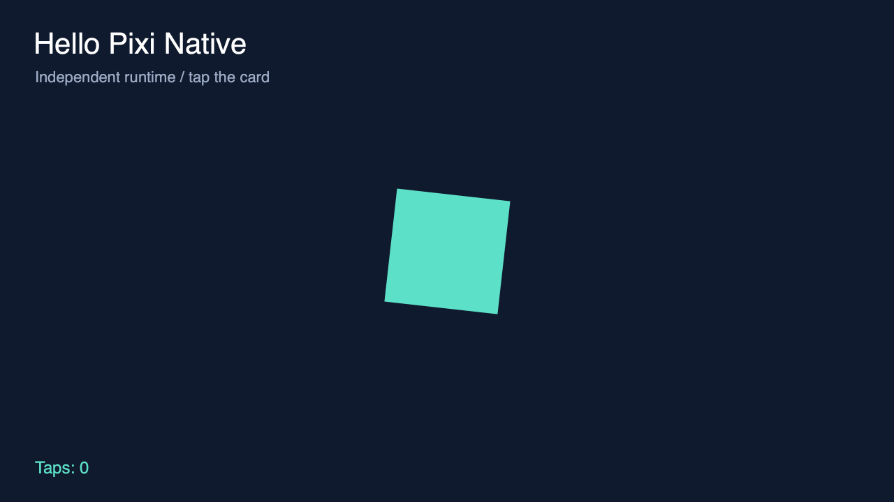

# pixi_native

An experimental native runtime for PixiJS on **Android, iOS and macOS**. JavaScript runs on V8 or JavaScriptCore; a shared C++ scene graph and OpenGL ES renderer draw the application. macOS uses ANGLE with Metal. This project does not render a WebView.

这是独立的 Pixi 原生底座开源项目，欢迎通过 Issue 和 Pull Request 一起完善。仓库只包含运行时源码、构建工具、通用示例、测试和文档，不包含游戏业务、游戏资源、广告支付统计 SDK、内部后端配置或旧仓库历史。

**当前没有完整支持 Pixi 8。** Public APIs target `pixi.js@8.20.0`, with a private Pixi 7.4.3 resource bridge. Read [支持范围与已知限制](docs/pixi8-support-boundary.zh-CN.md) before integrating a game. Custom shaders, WebGPU, RenderGroup/RenderLayer, HTMLText and several texture/text paths remain unsupported. A successful build or startup is not full compatibility acceptance.

Project-owned code is [MIT licensed](LICENSE). **Bundled third-party components retain their own licenses; Spine is not MIT and is still linked by the current native build.** See [third party notices](THIRD_PARTY_NOTICES.md).



## Quick start

Node.js 20 or later and CMake 3.20 or later are required. Clone this repository, then run:

```sh
npm ci
npm test
node tools/kit.mjs prepare examples/hello-pixi/app.config.json
cmake -S . -B build-core
cmake --build build-core -j4
ctest --test-dir build-core --output-on-failure
```

`npm ci` also runs the local `prepare` lifecycle script to generate the default example. `game/` and `generated/` are disposable output and are never committed. Runtime builds do not depend on a separate game repository or a project server.

## Android

Install JDK 21, Android SDK 36, NDK `27.2.12479018` and Android CMake `3.22.1`. Set `JAVA_HOME` and `ANDROID_HOME`, or provide the SDK path in ignored `android/local.properties`.

```sh
npm run build:android
```

Output: `android/app/build/outputs/apk/debug/app-debug.apk`. The first build downloads the pinned V8 prebuilt from its public upstream and verifies its checksum. Gradle also needs internet access for public build dependencies. Default example ABIs are arm64-v8a and x86_64; minimum Android version is API 26.

## iOS

Use macOS and a full Xcode installation. There are no CocoaPods or business SDK dependencies.

```sh
npm run build:ios
```

This builds an unsigned arm64 iOS Simulator app, with deployment target iOS 15.0. Output: `build-ios-simulator/DerivedData/Build/Products/Debug-iphonesimulator/PixiNativeApp.app`. Device signing, Archive and App Store submission are not configured by this command.

## macOS

Use macOS, Xcode and an ANGLE installation matching the target architecture. Supply a directory containing `include/EGL`, `include/GLES3`, `lib/libEGL.dylib` and `lib/libGLESv2.dylib`. Build ANGLE from its [official development instructions](https://chromium.googlesource.com/angle/angle/+/main/doc/DevSetup.md), retaining its license notices.

```sh
ANGLE_ROOT=/absolute/path/to/angle npm run build:mac
```

Output: `build-mac/DerivedData/Build/Products/Debug/PixiNativeApp.app`. The build copies the ANGLE libraries into the app bundle. ANGLE binaries and machine-specific paths are not committed. The deployment target is macOS 12.0; select architectures through CMake when building manually.

## Add your own project

Copy `examples/hello-pixi` into your project directory. Configure the app identity, entry, assets, fonts and platform options in `app.config.json`. The entry is a normal bundled script:

```js
globalThis.PixiNativeApp = {
  async start({ PIXI }) {
    const app = new PIXI.Application();
    await app.init({ width: 720, height: 1280, background: 0x101a2e });
    app.stage.addChild(new PIXI.Graphics().circle(100, 100, 40).fill(0x5de0c8));
    return app;
  }
};
```

Set `pixiVersion` to `8`, use the `PIXI` from the entry context, and return the Application. Project entry and asset paths must remain inside the project directory. Bundle ESM/TypeScript before passing it to the runtime. Do not bundle another Pixi instance into the entry. Fonts are explicitly registered with the `fonts` map in project configuration.

```sh
node tools/kit.mjs build android /path/to/project/app.config.json
node tools/kit.mjs build ios /path/to/project/app.config.json
ANGLE_ROOT=/path/to/angle node tools/kit.mjs build mac /path/to/project/app.config.json
```

## Validation and contribution

See [current validation](docs/validation.md), [architecture](docs/architecture.md), [compatibility limits](docs/pixi8-support-boundary.zh-CN.md), [API export inventory](docs/pixi8-api-audit.json) and [roadmap](ROADMAP.md). Report which platform was compiled and which device actually ran a change.

To contribute, read [CONTRIBUTING.md](CONTRIBUTING.md). Focused reproductions, native pixel comparisons, API contract tests and real-device performance evidence are welcome. This is a development baseline, not a promise of production readiness or compatibility with every Pixi plugin.
