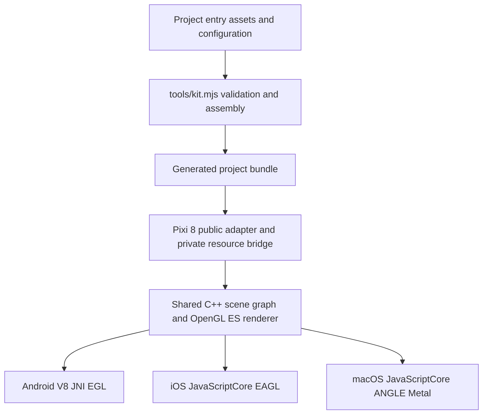

# Architecture

The core owns rendering, scene-node lifetime, resources, text rasterization, input, audio and platform lifecycle. The project owns its entry, assets, configuration and business behavior. There are no default game servers or account systems.

`src/compat/` adapts the public Pixi 8 interface. `src/js/` contains shared host fragments and resource/lifetime contracts. `src/cmdbuf/` owns the native renderer and scene graph. Android uses a JSC-shaped V8 bridge; Apple platforms use JavaScriptCore. Auxiliary Spine and UI rendering bridges remain internal implementation components and are not promises of plugin API compatibility.

Project configuration is validated and assembled into ignored `game/` and `generated/` directories. Android Gradle and Apple CMake consume those outputs. The public repository starts from a clean source snapshot; no private Git history, game bundle, SDK configuration or machine manifest is needed to build it.
